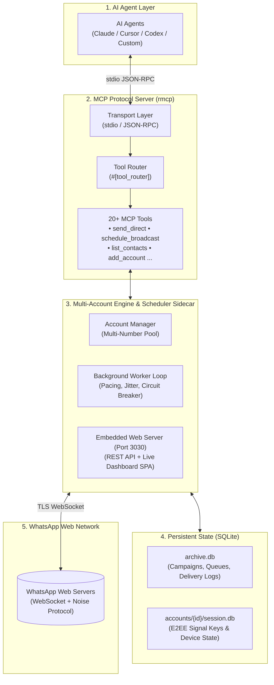

<p align="center">
  
</p>

<h1 align="center">Wasche</h1>

<p align="center">
  <strong>Native WhatsApp Model Context Protocol (MCP) Server, Background Scheduler Sidecar & Multi-Account Engine</strong>
</p>

<p align="center">
  <a href="LICENSE"></a>
  <a href="https://github.com/modelcontextprotocol/rust-sdk"></a>
  <a href="https://www.rust-lang.org"></a>
  <a href="https://astro.build"></a>
</p>

---

## Overview

**Wasche** is a native Rust-powered **Model Context Protocol (MCP)** server and persistent background scheduler sidecar for WhatsApp. It enables AI agents (Claude, Cursor, Codex, Gemini, etc.) to safely orchestrate multiple WhatsApp phone numbers, query contacts, dispatch interactive media, and execute high-durability broadcast campaigns protected by human behavioral emulation heuristics.

### Key Capabilities

- **20+ Native MCP Tools**: Full programmatic control over direct messaging, QR/phone code linking, contact management, and anti-ban campaign automation.
- **Embedded Web Dashboard**: Modern client-side SPA (Astro + SolidJS) on port `3030` providing live progress meters, speech bubble chat preview, WhatsApp Photo Studio, and Video Frame Trimmer.
- **Multi-Account Concurrency**: Run multiple WhatsApp numbers simultaneously in a single daemon with automated load balancing and independent rate pacing.
- **Anti-Ban Heuristics**: Proportional typing presence (`Chatstate::Composing`), randomized inter-recipient jitter (e.g. 25–90s), single-flight transaction locks, and 3-strike circuit breakers.
- **SQLite Persistence**: Complete local storage for Noise E2EE session keys, campaign queues, contacts, and delivery audit logs with automatic WAL checkpointing.

---

## Architecture



---

## Quick Start

### 1. Using `npx` (No Manual Installation)

Run the server directly through npx:

```bash
npx wasche
```

### 2. Configure with MCP Clients

Add Wasche to your MCP client configuration (`claude_desktop_config.json`, Cursor, or `.mcp.json`):

```json
{
  "mcpServers": {
    "wasche": {
      "command": "npx",
      "args": ["-y", "wasche"],
      "env": {
        "RUST_LOG": "info"
      }
    }
  }
}
```

### 3. Build from Source

Requirements: **Rust 1.88+ (2024 edition)**, **Node.js 20+**, and **pnpm 9+**.

```bash
# 1. Clone repository
git clone https://github.com/your-org/wasche.git
cd wasche

# 2. Build web dashboard frontend
cd dashboard
pnpm install
pnpm build
cd ..

# 3. Compile release binary
cargo build --release

# 4. Run Wasche daemon
./target/release/wasche
```

The web dashboard will be available at **`http://127.0.0.1:3030`**.

---

## MCP Tools Catalog

Wasche exposes 20 declarative tools for LLM agent integration:

| Tool Name | Key Parameters | Description |
| :--- | :--- | :--- |
| `whatsapp_list_accounts` | _none_ | Lists all registered WhatsApp accounts, connection states, and active indicator. |
| `whatsapp_add_account` | `account_id` | Registers a new account connection and initializes pairing session. |
| `whatsapp_set_active_account` | `account_id` | Switches the default active account for subsequent tool invocations. |
| `whatsapp_remove_account` | `account_id` | Shuts down account engine, drops connection, and removes local workspace. |
| `whatsapp_rename_account` | `old_id`, `new_id` | Renames an account identifier across databases and directories. |
| `whatsapp_get_status` | `account_id?` | Checks WhatsApp connection status, paired phone number, and push name. |
| `whatsapp_get_qr_code` | `account_id?` | Generates QR code (raw string, terminal ASCII, deep link, SVG HTML file). |
| `whatsapp_pair_with_phone` | `phone_number`, `account_id?` | Generates an 8-character pairing code to link phone without scanning QR. |
| `whatsapp_send_direct` | `recipient`, `message?`, `attachment_path?`, `send_as?`, `account_id?` | Sends an immediate 1:1 message, photo/video, or document attachment. |
| `whatsapp_send_media` | `recipient`, `file_path`, `caption?`, `account_id?` | Sends an inline photo, video, or audio file (max 16 MB) with optional caption. |
| `whatsapp_send_document` | `recipient`, `file_path`, `caption?`, `file_name?`, `account_id?` | Sends a raw uncompressed file attachment (up to 100 MB+) with optional caption. |
| `whatsapp_list_contacts` | `query?`, `limit?`, `account_id?` | Searches and lists local address book contacts by name or phone number. |
| `whatsapp_sync_contacts` | `account_id?` | Triggers Peer AppState contact sync (`CriticalUnblockLow`) to fetch address book names. |
| `whatsapp_schedule_broadcast`| `name`, `template`, `recipients`, `attachment_path?`, `send_as?`, `account_id?`, `scheduled_at?`, `min_delay?`, `max_delay?` | Schedules or launches an anti-ban broadcast campaign with human-like pacing. |
| `whatsapp_get_broadcast_status` | `campaign_id` | Retrieves real-time delivery statistics, progress counts, and execution logs. |
| `whatsapp_control_broadcast` | `campaign_id`, `action` | Controls an active campaign (`pause`, `resume`, `abort`, `delete`). |
| `whatsapp_list_broadcasts` | `status?`, `account_id?` | Lists broadcast campaigns filtered by status and/or account. |
| `whatsapp_delete_broadcast` | `campaign_id` | Permanently deletes a campaign and its recipient queue from SQLite. |
| `whatsapp_update_campaign_template` | `campaign_id`, `template_body` | Updates the message template of an existing campaign. |
| `whatsapp_open_dashboard` | _none_ | Opens the live web dashboard in the default browser. |

---

## Anti-Abuse Threat Model & Pacing Mechanics

Wasche incorporates multi-layer safeguards against automated rate-limiting:

| Anti-Abuse Layer | Detection Vector | Mitigation Mechanism | Implementation Formula |
| :--- | :--- | :--- | :--- |
| **Typing Presence** | Instantaneous stanzas | Proportional Typing Delays | $t_{\text{typing}} = \operatorname{clamp}\Big(\text{len}(\text{msg}) \times \mathcal{U}(30, 50)\text{ ms},\; 1.5\text{ s},\; 8.0\text{ s}\Big)$ |
| **Chatstate Emulation** | Zero-presence outbound | `Chatstate::Composing` Stanzas | Sends explicit typing stanzas followed by paused state. |
| **Inter-Message Pacing**| Rigid periodic intervals | Bounded Jitter Delay Window | Uniform random cooldown: $t_{\text{wait}} \sim \mathcal{U}(\text{min\_delay},\; \text{max\_delay})$ (25–90s default). |
| **Queue Concurrency** | Socket collision | Strict Single-Flight Queue | Mutex-guarded atomic SQLite checkout per sending SIM card. |
| **Content Variance** | Static content hashes | Template Token Interpolation | Dynamic substitution of `{{name}}`, `{{phone}}`, and custom variables. |
| **Circuit Breakers** | Consecutive dispatches | 3-Strike Exponential Backoff | Quarantines accounts after consecutive protocol errors to protect reputation. |

---

## Data Storage Locations

Wasche stores persistent data in the platform user application data directory:

- **Windows**: `C:\Users\<User>\AppData\Roaming\wasche\wasche\data\`
- **Linux**: `~/.local/share/wasche/`
- **macOS**: `~/Library/Application Support/com.wasche.wasche/`

Override via environment variable:
```bash
export WASCHE_DATA_DIR="/custom/path/to/data"
```

---

## Technical Documentation

Detailed architectural deep dives and durability models are available in [`docs/`](docs/):

- [Architecture Specification](docs/whatsapp-mcp-scheduler-architecture.md)
- [Broadcast Durability & Anti-Abuse Realities](docs/broadcast-durability-and-anti-abuse.md)
- [WhatsApp Media & Multi-Attachment Protocol Realities](docs/whatsapp-media-multi-attachment-realities.md)

---

## License

Licensed under the **Apache License, Version 2.0**. See [LICENSE](LICENSE) for details.
