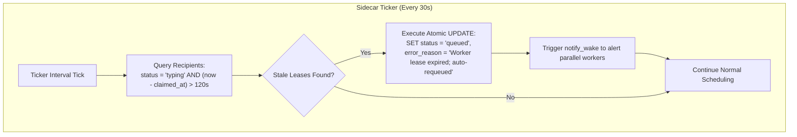
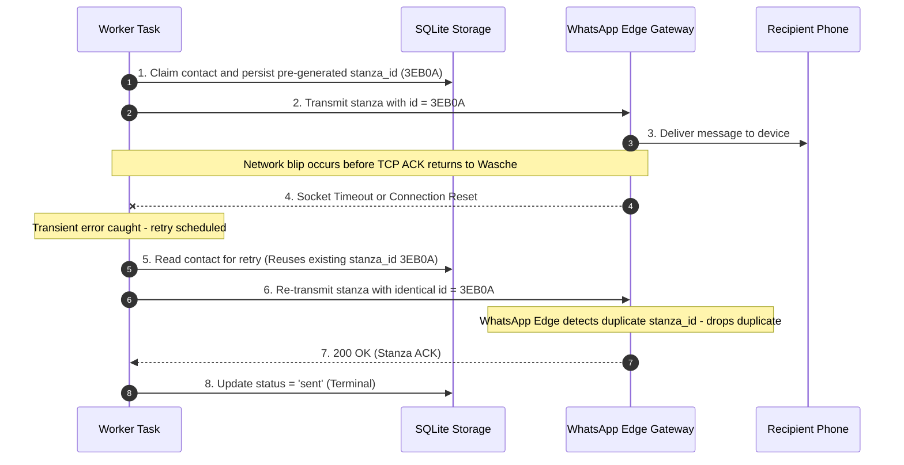
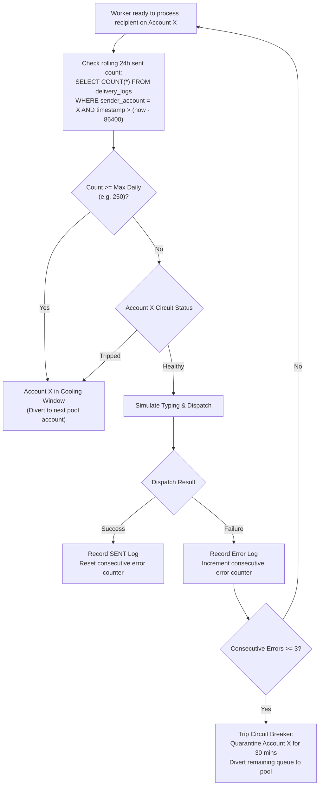
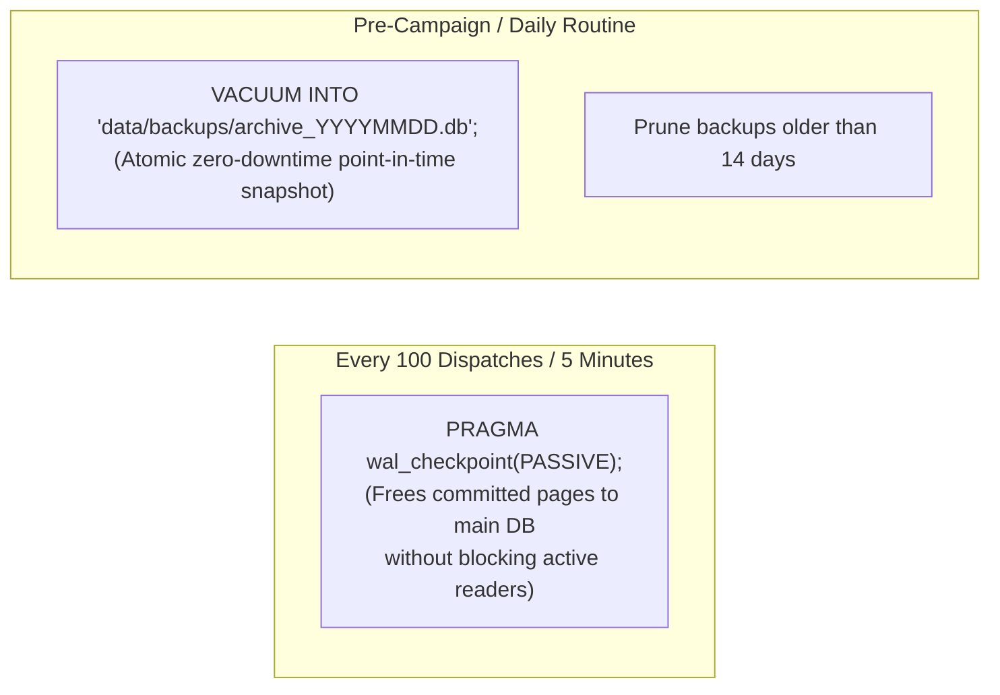
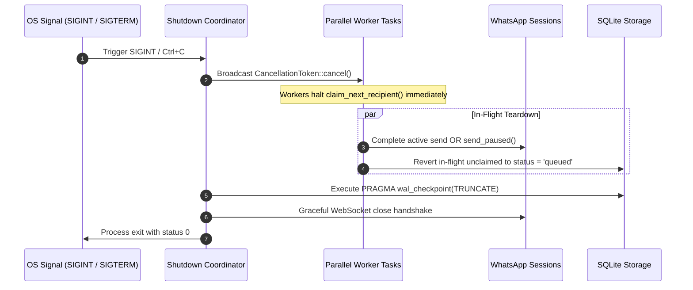

# Broadcast Durability & Anti-Abuse Technical Considerations (Wasche)

This document establishes the **production durability engineering specifications** and **anti-abuse architectural considerations** for the [[WhatsApp MCP Server & Scheduler Sidecar|Wasche]] background broadcast engine. It analyzes failure modes across in-flight lease deadlocks, network-boundary idempotency races, macro velocity limits, storage maintenance, and cooperative process shutdown.

---

## 1. Durability Failure Vectors & Mitigations Matrix

| Failure Mode | Root Cause | System Impact | Technical Mitigation |
| :--- | :--- | :--- | :--- |
| **Zombie Task Deadlock** | Async task stall or panic while recipient is `'typing'` | Campaign hangs at 99% in `'running'` status forever | **In-Flight Lease Heartbeat Sweep** (Auto-requeue if elapsed $> 120\text{ s}$) |
| **Network-Boundary Duplicate** | Socket drop after WhatsApp accept but before TCP ACK | Recipient receives duplicate message | **Pre-Persisted Stanza ID** (Reuse exact stanza ID on retry) |
| **Account Burn / Flagging** | No macro 24h ceiling; micro-jitter only | Server-side ML ban (`403` / `E::LoggedOut`) | **Rolling 24h Quota & 3-Strike Error Circuit Breaker** |
| **Storage Bloat / Degradation** | Unbounded `-wal` growth under continuous logging | Slow cold starts, high memory, corruption risk | **Periodic Passive WAL Checkpoint & Online VACUUM INTO Snapshots** |
| **Abrupt Socket Teardown** | SIGINT/SIGTERM drops Tokio runtime immediately | In-flight typing left on; uncommitted SQLite pages | **Cooperative CancellationToken Shutdown Handshake** |
| **Partial Multi-Attachment Failure** | Network drops on file #2 of a multi-media batch | Contact receives half-payload, reported falsely as sent | **Fail-Fast Batch Rollback** (Halts batch, aborts `'sent'`, triggers retry) |
| **Attachment Stanza Deduplication** | Same stanza ID reused across files in a multi-send | WhatsApp drops files #1..N as network replays | **Isolated Message ID Allocation** (`outbound_stanza_id` for #0, unique IDs for #1..N) |
| **Transient Reconnect State Race** | Socket keepalive blip wipes in-memory status | UI falsely reports no devices connected (red dot); phone number drops | **Storage Identity Fallback & Dynamic Self-Healing** (Read `session.db` device identity; `client.pn()` sync) |
---

## 2. In-Flight Lease Expiration & Zombie Task Recovery

### 2.1 The Deadlock Mechanism
Under the [[WhatsApp MCP Server & Scheduler Sidecar#13-parallel-multi-worker-pipeline--anti-duplicate-architecture|Parallel Multi-Worker Pipeline]], a worker claims a contact via `claim_next_recipient()`, atomically transitioning status from `'queued'` to `'typing'`.
- If an unhandled network stall or worker task drop occurs while the process remains running, the recipient remains in `'typing'` state indefinitely.
- Because `has_pending_recipients()` evaluates `status IN ('queued', 'typing')`, the campaign assumes work is still in flight and never marks the execution run as completed.

### 2.2 Lease Sweep Architecture



### 2.3 Database Blueprint
1. **Schema Extension**:
   ```sql
   ALTER TABLE broadcast_recipients ADD COLUMN claimed_at INTEGER;
   ```
2. **Atomic Claim Update**:
   ```sql
   UPDATE broadcast_recipients 
   SET status = 'typing', claimed_at = ?1 
   WHERE id = ?2;
   ```
3. **Lease Recovery Query**:
   ```sql
   UPDATE broadcast_recipients 
   SET status = 'queued', 
       error_reason = 'Worker lease expired (task timeout); auto-requeued',
       claimed_at = NULL
   WHERE campaign_id = ?1 
     AND status = 'typing' 
     AND (?2 - claimed_at > 120);
   ```

    participant WA as WhatsApp Edge Gateway
    participant Recipient as Recipient Phone

    Worker->>DB: 1. Claim contact & persist pre-generated stanza_id (3EB0A...)
    Worker->>WA: 2. Transmit stanza with id = 3EB0A...
    WA->>Recipient: 3. Deliver message to device
    Note over Worker,WA: Network blip occurs before TCP ACK returns to Wasche
    WA--xWorker: 4. Socket Timeout / Connection Reset

    Note over Worker: Transient error caught; retry scheduled
    Worker->>DB: 5. Read contact for retry (Reuses existing stanza_id 3EB0A...)
    Worker->>WA: 6. Re-transmit stanza with identical id = 3EB0A...
    Note over WA: WhatsApp Edge detects duplicate stanza_id; drops duplicate
    WA-->>Worker: 7. 200 OK (Stanza ACK)
    Worker->>DB: 8. Update status = 'sent' (Terminal)
```

### 3.3 Database Blueprint
1. **Schema Extension**:
   ```sql
   ALTER TABLE broadcast_recipients ADD COLUMN outbound_stanza_id TEXT;
   ```
2. **Claim & Persist**:
   ```sql
   UPDATE broadcast_recipients 
   SET status = 'typing', 
       claimed_at = ?1, 
       outbound_stanza_id = ?2 
   WHERE id = ?3;
   ```
3. **Dispatch Handler**:
   If `recipient.outbound_stanza_id` is populated, pass it directly to `SendOptions::with_message_id()` rather than generating a fresh ID.

---

## 4. Macro Velocity Regulation & Circuit Breakers

While micro-pacing ($25\text{--}90\text{ s}$ per recipient) regulates short-term burstiness, it does not prevent accounts from exceeding daily macro thresholds that trigger automated spam scoring.

### 4.1 WhatsApp Server-Side Risk Scoring Matrix

| Heuristic Signal | Risk Factor | Safe Operating Zone | High-Risk Trigger Zone |
| :--- | :--- | :--- | :--- |
| **Spam Report / Block Rate** | Critical | $< 0.5\%$ of recipients | $\ge 3$ reports in 1 hour |
| **Contact Book Asymmetry** | High | Mutual contacts | 100% cold numbers |
| **Bidirectional Ratio** | High | Inbound replies $> 5\%$ | Outbound only (0 replies) |
| **Macro 24h Message Volume** | Medium-High | 150–300 msgs/day | $> 500$ msgs/day on 1 SIM |
| **Micro Burst Velocity** | Medium | 1–1.5 msgs/min | $> 3$ msgs/min sustained |

### 4.2 Rolling 24-Hour Quota & Circuit Breaker Logic



### 4.3 Database Blueprint
```sql
-- Rolling 24-hour volume calculation per account
SELECT COUNT(*) 
FROM broadcast_delivery_logs 
WHERE sender_account = ?1 
  AND status = 'sent' 
  AND timestamp > (?2 - 86400);

-- Consecutive error calculation for circuit breaking
SELECT status, error_reason 
FROM broadcast_delivery_logs 
WHERE sender_account = ?1 
ORDER BY timestamp DESC, id DESC 
LIMIT 3;
```

---

## 5. SQLite Storage Maintenance & Online Backups

### 5.1 The WAL Growth Problem
In WAL mode (`PRAGMA journal_mode = WAL`), readers do not block writers and writers do not block readers. However, continuous broadcast logging appends pages to `archive.db-wal`. Without active checkpointing, the WAL file grows unbounded, leading to:
- Increased memory usage during query planning.
- Slower cold-start recovery times.
- Heightened vulnerability to journal corruption during hard system crashes.

### 5.2 Storage Maintenance Lifecycle



### 5.3 Maintenance Execution in Rust
```rust
// Periodic passive checkpoint in SidecarWorker loop
let conn = archive.conn.lock().unwrap();
let _ = conn.execute_batch("PRAGMA wal_checkpoint(PASSIVE);");

// Pre-campaign atomic backup
let backup_path = format!("data/backups/archive_{}.db", now_secs());
let _ = conn.execute("VACUUM INTO ?1", params![backup_path]);
```

---

## 6. Cooperative Process Shutdown Coordinator

### 6.1 Abrupt vs. Cooperative Teardown
- **Abrupt (Current)**: Process exit cuts the Tokio event loop mid-flight. Sockets close with `RST`, chats remain flagged with `Chatstate::Composing` on recipient devices, and in-flight recipients remain stuck in `'typing'`.
- **Cooperative (Target)**: Broadcasts a cancellation signal across all worker tasks, allows in-flight sends to finish, sends `send_paused()`, and truncates WAL logs before terminating.

### 6.2 Shutdown Sequence



---

## 7. Implementation Priority & Component Touchpoint Matrix

| Durability Component | Severity | Complexity | Primary Files & Symbols | Phase Tier |
| :--- | :--- | :--- | :--- | :--- |
| **1. In-Flight Lease Heartbeat Sweep** | Critical | Low (1h) | `src/archive.rs` (`claim_next_recipient`), `src/sidecar.rs` (ticker) | P0 Immediate |
| **2. Rolling 24h Quota & Circuit Break** | High | Low (2h) | `src/sidecar.rs` (`run_account_worker`), `src/archive.rs` | P1 High |
| **3. Pre-Persisted Stanza IDs** | Medium | Medium (2h) | `src/archive.rs`, `src/whatsapp.rs` (`send_media`, `send_text`) | P2 Next |
| **4. Cooperative Shutdown Coordinator** | Medium | Medium (2h) | `src/main.rs`, `src/sidecar.rs`, `tokio::signal::ctrl_c` | P2 Next |
| **5. Automated WAL Checkpointing** | Maintenance | Low (30m) | `src/archive.rs`, `src/sidecar.rs` | P3 Routine |

---

## 8. Cross-References
- [[WhatsApp MCP Server & Scheduler Sidecar]] — System architecture, multi-account routing, and Parallel Multi-Worker Pipeline.
- [[WhatsApp Media & Multi-Attachment Protocol Realities]] — Wire protocol mutual exclusivity, media albums, HTTP 206 streaming, and attachment durability.
- [[Safe WhatsApp Broadcast]] — Upstream keystroke simulation and human-pacing heuristics.
- [[Peer Data Synchronization]] — CriticalUnblockLow AppState sync patterns.
