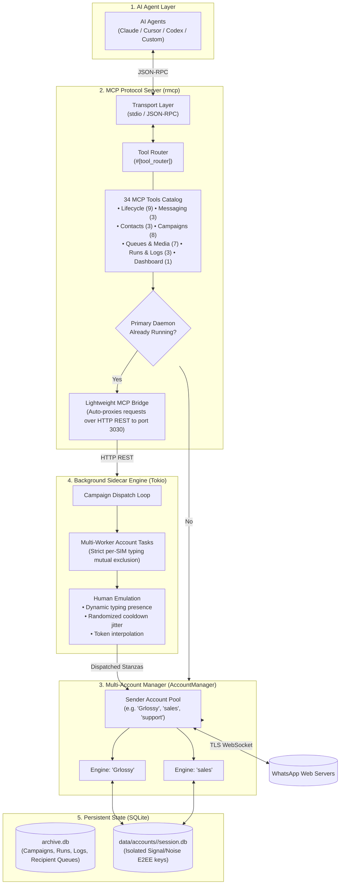
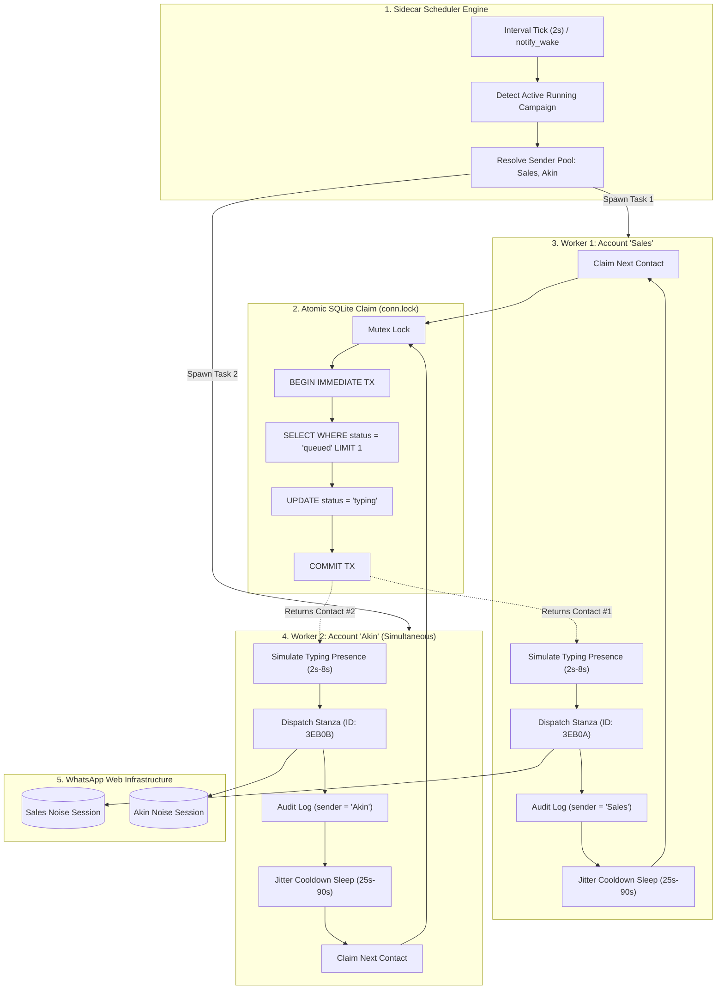
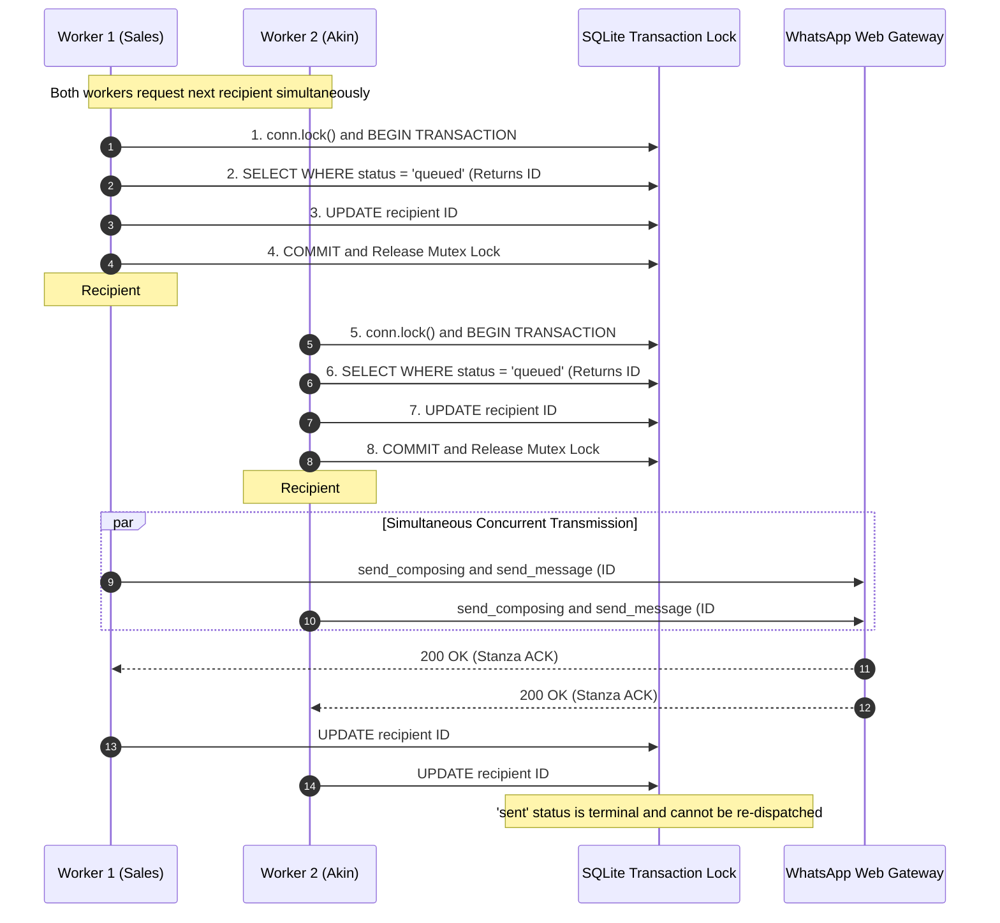
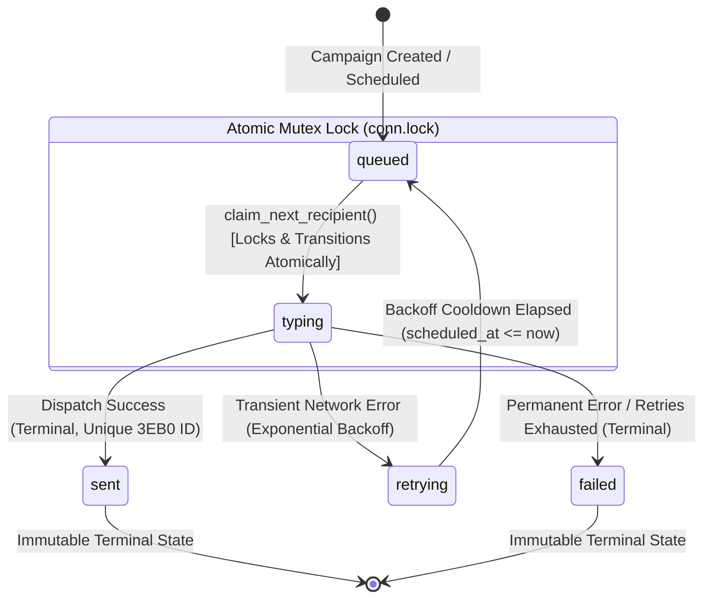

# WhatsApp MCP Server & Scheduler Sidecar (Wasche)

The **Wasche** project provides an official [Model Context Protocol (MCP)](https://github.com/modelcontextprotocol/rust-sdk) server, persistent background scheduler sidecar, and **concurrent multi-account manager** for WhatsApp, implemented natively in Rust. It enables AI agents (Claude, Codex, Gemini, Cursor, etc.) to securely automate and orchestrate multiple WhatsApp phone numbers while hosting an anti-ban sidecar engine based on [[Safe WhatsApp Broadcast]] and [[Peer Data Synchronization]].

> [!INFO] Reference Engine
> Protocol engine and pacing mechanics derive from production-tested native WhatsApp architecture (`whatsapp-rust`, Tokio transport, dynamic typing presence, SQLite recipient queuing, and Peer AppState sync `CriticalUnblockLow`).

---

## 1. System Architecture



---

## 2. Multi-Account Management & Dual-Mode Execution Model

Wasche supports running multiple WhatsApp phone numbers concurrently within a single host process or across multiple agent sessions:

1. **Storage Isolation**:
   - Each account maintains an isolated Signal/Noise session store:
     `data/accounts/<account_id>/session.db`
   - Preserves independent identity keys, prekeys, and multi-device pairings.
2. **Dual-Mode Process Architecture (Primary Daemon vs. Lightweight MCP Bridge)**:
   - **Primary Daemon Mode**: When launched as the first process (or via background daemon), Wasche binds TCP port `3030` (with automatic discovery fallback to `3031`..`3035`), starts the HTTP REST API, runs the scheduler sidecar, and maintains persistent WebSocket connections.
   - **Lightweight MCP Bridge Mode**: When subsequent MCP client sessions (e.g. subagents, parallel CLI turns) start up, Wasche probes the local port. Finding a live primary daemon, it enters lightweight bridge mode—forwarding all 34 tool calls via HTTP to the primary daemon with zero database lock contention or port conflicts.
3. **Multi-Sender Account Pooling**:
   - Campaigns can bind to a single sender (`account_id: "Grlossy"`), multiple senders (`account_id: "Grlossy, sales"`), or all connected senders (`account_id: "all"`).
   - The sidecar spawns parallel account workers for each pooled account. Atomic database claims ensure sequential message dispatch per WhatsApp line while load-balancing the shared queue.
4. **Dynamic On-The-Fly Linking & Pairing**:
   - Call `whatsapp_add_account("sales")` to register a new account on demand.
   - Immediately call `whatsapp_get_qr_code({"account_id": "sales"})` or `whatsapp_pair_with_phone` to link the new phone.
   - Call `whatsapp_reset_account_pairing` to reset local session keys without losing campaign history.

## 3. Anti-Abuse Threat Model & Pacing Mechanics

Adopted directly from [[Safe WhatsApp Broadcast]]:

| Anti-Abuse Layer | Detection Vector | Threat Model & Risk | Mitigation Mechanism in Wasche | Technical Implementation |
| :--- | :--- | :--- | :--- | :--- |
| **Typing Presence** | Instantaneous Stanzas | Immediate message injection without prior presence stanzas triggers bot heuristics. | Proportional Typing Delays | `t_typing = clamp(len(message) * U(30..50ms), 1.5s, 8.0s)` |
| **Chatstate Emulation** | Zero-Presence Outbound | Sending messages while appearing offline trips behavioral analysis flags. | `Chatstate::Composing` Stanzas | Sends explicit typing stanzas to WhatsApp before transmission, followed by `Chatstate::Paused`. |
| **Inter-Message Pacing** | Rigid Periodic Intervals | Fixed timing intervals (e.g. exactly 5.00s) indicate automated cron scripts. | Bounded Jitter Delay Window | Random uniform cooldown: `t_wait ~ U(min_delay, max_delay)` (default 25s–90s). |
| **Queue Concurrency** | Concurrent Dispatches | Multiple simultaneous dispatches from a single session cause immediate rate-limit bans. | Strict Single-Flight Queue | Atomic SQLite checkout (`status = 'typing'`) ensures sequential delivery per linked account. |
| **Content Variance** | Static Content Hashes | Identical hash across hundreds of outbound messages triggers WhatsApp spam filters. | Template Token Interpolation | Dynamic substitution of `{{name}}`, `{{phone}}`, and custom JSON payload variables per recipient. |
| **Recipient Trust** | Recipient Spam Reports | Outbound cold messages to unknown numbers result in block/report actions. | Mutual Contact Address Book Sync | Background Peer AppState Sync (`CriticalUnblockLow`) maps and verifies existing address book contacts. |

- **Dynamic Typing Presence**:
  $$t_{\text{typing}} = \text{clamp}\Big(\text{len}(\text{message}) \times \mathcal{U}(30, 50)\text{ ms},\; 1.5\text{ s},\; 8.0\text{ s}\Big)$$
- **Bounded Inter-Recipient Jitter**:
  $$t_{\text{wait}} \sim \mathcal{U}(t_{\text{min}},\; t_{\text{max}})$$

---

## 4. MCP Tools Catalog (34 Tools)

Wasche exposes **34 declarative tools** across 7 functional categories:

### 1. Account & Connection Lifecycle (9 Tools)
| Tool Name | Key Parameters | Operational Description |
| :--- | :--- | :--- |
| `whatsapp_list_accounts` | _none_ | Lists all configured accounts, their connection state, phone number, and active flag. |
| `whatsapp_add_account` | `account_id: string` | Registers a new account connection and immediately begins pairing. |
| `whatsapp_set_active_account` | `account_id: string` | Switches the default active account for subsequent tool invocations. |
| `whatsapp_remove_account` | `account_id: string` | Shuts down the engine, drops the BotHandle, removes managed account records, and purges workspace files. |
| `whatsapp_rename_account` | `old_id: string`, `new_id: string` | Renames an account identifier across databases, directories, and campaigns. |
| `whatsapp_get_status` | `account_id?: string` | Returns connection status (`Connected`, `PairingQr`, `Disconnected`) for an account. |
| `whatsapp_get_qr_code` | `account_id?: string` | Generates QR code (raw, deep link, ASCII art, HTML preview) for an account. |
| `whatsapp_pair_with_phone` | `phone_number: string`, `account_id?: string` | Requests an 8-character pairing code to link by phone number instead of QR. |
| `whatsapp_reset_account_pairing` | `account_id: string` | Clears local pairing session and keys, preparing for fresh QR/code generation. |

### 2. Direct Messaging & Media (3 Tools)
| Tool Name | Key Parameters | Operational Description |
| :--- | :--- | :--- |
| `whatsapp_send_direct` | `recipient: string`, `message?: string`, `attachment_path?: string`, `send_as?: "media" \| "document"`, `account_id?: string` | Sends an immediate 1:1 message, photo/video media, or raw document attachment. |
| `whatsapp_send_media` | `recipient: string`, `file_path: string`, `caption?: string`, `account_id?: string` | Sends an immediate inline photo, video, or audio file (max 16MB) with optional caption. |
| `whatsapp_send_document` | `recipient: string`, `file_path: string`, `caption?: string`, `file_name?: string`, `account_id?: string` | Sends an immediate document or raw uncompressed file (up to 100MB) with optional caption. |

### 3. Contacts & Address Book (3 Tools)
| Tool Name | Key Parameters | Operational Description |
| :--- | :--- | :--- |
| `whatsapp_list_contacts` | `query?: string`, `account_id?: string`, `limit?: u32` | Searches local archive contacts by name or phone with account filtering. |
| `whatsapp_sync_contacts` | `account_id?: string` | Triggers Peer AppState Sync (`CriticalUnblockLow` snapshot replay) to fetch address book names. |
| `whatsapp_get_contact_avatar` | `jid: string`, `account_id?: string` | Fetches the high-resolution profile avatar picture URL for a contact JID. |

### 4. Broadcast Campaigns & Anti-Ban Pacing (8 Tools)
| Tool Name | Key Parameters | Operational Description |
| :--- | :--- | :--- |
| `whatsapp_schedule_broadcast` | `name`, `template`, `recipients`, `attachment_path?`, `send_as?`, `account_id?`, `account_ids?`, `scheduled_at?`, `min_delay_secs?`, `max_delay_secs?` | Queues an anti-ban broadcast campaign with multi-sender pooling and customizable jitter. |
| `whatsapp_list_broadcasts` | `status?: string`, `account_id?: string` | Lists campaigns filtered by status and/or account. |
| `whatsapp_get_broadcast_status` | `campaign_id: i64` | Queries real-time delivery metrics, execution runs, and recent logs. |
| `whatsapp_control_broadcast` | `campaign_id: i64`, `action: string` | Controls an active campaign (`pause`, `resume`, `abort`, `delete`, `rerun`, `retry_failed`). |
| `whatsapp_delete_broadcast` | `campaign_id: i64` | Permanently deletes a campaign and its recipient queue from SQLite. |
| `whatsapp_rename_campaign` | `campaign_id: i64`, `name: string` | Renames an existing broadcast campaign. |
| `whatsapp_update_campaign_template` | `campaign_id: i64`, `template: string` | Updates the message template of an existing campaign. |
| `whatsapp_update_campaign_delay_range` | `campaign_id: i64`, `min_delay_secs: u32`, `max_delay_secs: u32` | Updates anti-ban jitter delay range between consecutive messages. |

### 5. Campaign Queue, Attachments & Sender Pooling (7 Tools)
| Tool Name | Key Parameters | Operational Description |
| :--- | :--- | :--- |
| `whatsapp_list_campaign_recipients` | `campaign_id: i64`, `query?: string`, `status?: string`, `limit?: u32`, `offset?: u32` | Lists campaign target recipients with search and status filtering (`queued`, `sent`, `failed`). |
| `whatsapp_add_campaign_recipients` | `campaign_id: i64`, `recipients: Vec<RecipientInput>` | Adds target contacts with optional custom variable values to an existing campaign. |
| `whatsapp_delete_campaign_recipients` | `campaign_id: i64`, `recipient_ids: Vec<i64>` | Removes recipient contacts from an existing broadcast campaign queue. |
| `whatsapp_resend_recipient` | `campaign_id: i64`, `recipient_id: i64` | Requeues an individual recipient that previously failed or was aborted. |
| `whatsapp_attach_campaign_media` | `campaign_id: i64`, `file_path: string`, `send_as?: string` | Attaches a media or document file to an existing campaign. |
| `whatsapp_remove_campaign_attachments` | `campaign_id: i64`, `file_name?: string` | Removes specific or all attachments from an existing broadcast campaign. |
| `whatsapp_set_campaign_attachment_mode` | `campaign_id: i64`, `file_name: string`, `send_as: string` | Toggles delivery mode (`media` vs `document`). |
| `whatsapp_add_campaign_sender` | `campaign_id: i64`, `account_id: string` | Adds a sender WhatsApp account to an existing campaign for multi-account pooling. |
| `whatsapp_remove_campaign_sender` | `campaign_id: i64`, `account_id: string` | Removes a sender WhatsApp account from a campaign pool. |

### 6. Execution Runs & Delivery Logs (3 Tools)
| Tool Name | Key Parameters | Operational Description |
| :--- | :--- | :--- |
| `whatsapp_list_campaign_runs` | `campaign_id: i64`, `limit?: u32` | Lists all execution runs (Run #1, Run #2, etc.) with sent/failed counts, status, and duration. |
| `whatsapp_get_campaign_logs` | `campaign_id: i64`, `query?: string`, `status?: string`, `limit?: u32` | Retrieves delivery logs across all runs with search and status filtering. |
| `whatsapp_get_run_logs` | `campaign_id: i64`, `run_id?: i64`, `query?: string`, `status?: string`, `limit?: u32` | Retrieves detailed delivery logs for a specific run with search and status filtering. |

### 7. Dashboard & UI (1 Tool)
| Tool Name | Key Parameters | Operational Description |
| :--- | :--- | :--- |
| `whatsapp_open_dashboard` | _none_ | Launches the live web dashboard in the default browser (`http://127.0.0.1:3030`). |
---

## 5. Campaign Execution Run Tracking & Delivery Logs

To support auditable and repeatable broadcast campaigns, Wasche implements a multi-run execution architecture in SQLite:

### 5.1 SQLite Schema Extensions

```sql
CREATE TABLE IF NOT EXISTS broadcast_campaign_runs (
    id INTEGER PRIMARY KEY AUTOINCREMENT,
    campaign_id INTEGER NOT NULL REFERENCES broadcast_campaigns(id) ON DELETE CASCADE,
    run_number INTEGER NOT NULL DEFAULT 1,
    status TEXT NOT NULL DEFAULT 'running', -- running, completed, aborted, paused
    total_count INTEGER NOT NULL DEFAULT 0,
    sent_count INTEGER NOT NULL DEFAULT 0,
    failed_count INTEGER NOT NULL DEFAULT 0,
    started_at INTEGER NOT NULL,
    completed_at INTEGER
);

CREATE TABLE IF NOT EXISTS broadcast_delivery_logs (
    id INTEGER PRIMARY KEY AUTOINCREMENT,
    campaign_id INTEGER NOT NULL REFERENCES broadcast_campaigns(id) ON DELETE CASCADE,
    run_id INTEGER REFERENCES broadcast_campaign_runs(id) ON DELETE CASCADE,
    recipient_id INTEGER,
    jid TEXT NOT NULL,
    phone_number TEXT NOT NULL,
    display_name TEXT,
    status TEXT NOT NULL, -- sent, failed
    error_reason TEXT,
    message_id TEXT,
    timestamp INTEGER NOT NULL
);

CREATE INDEX IF NOT EXISTS idx_broadcast_runs_camp ON broadcast_campaign_runs (campaign_id, run_number);
CREATE INDEX IF NOT EXISTS idx_delivery_logs_run ON broadcast_delivery_logs (run_id);
```

### 5.2 Multi-Run Lifecycle

1. **Initial Run Creation**:
   - When a campaign is queued, an initial `Run #1` record is generated with `status = 'pending'`.
2. **Atomic Re-run (`rerun_campaign`)**:
   - When a campaign is re-run, previous active runs are cleanly completed/aborted.
   - Generates an incremental run record:
     $$\text{run\_number} = \max(\text{run\_number}) + 1$$
   - Resets recipient statuses back to `queued` within an atomic SQLite transaction.
   - Wakes up the background scheduler sidecar immediately via `notify_wake: Arc<tokio::sync::Notify>`.
3. **Per-Recipient Delivery Logging**:
   - Every outbound WhatsApp message dispatch commits an entry to `broadcast_delivery_logs` capturing the exact recipient JID, phone number, display name, delivery status (`sent` or `failed`), WhatsApp server message ID (`3EB0...`), and UNIX timestamp.

---

## 6. Scheduler Resilience & Double-Send Prevention

### 6.1 Single Daemon Leader Election
When multiple AI agent sessions or MCP clients spawn `wasche.exe` over `stdio`:
- **Primary Instance**: Successfully binds the HTTP Web Dashboard port (default `3030`), starts the Web Dashboard, and spawns the background `SidecarWorker::run()` scheduler loop.
- **Secondary Bridge Instances**: Detect that port `3030` is already in use by the active Wasche daemon and operate strictly as MCP tool bridges over `stdio`, avoiding redundant background queue workers.

### 6.2 Elimination of In-Loop Re-queueing
- In earlier revisions, `next_runnable_recipient()` inadvertently executed a batch recovery of `status = 'typing'` back to `'queued'` on every iteration.
- This caused the lowest-ID recipient to be perpetually reset back to `'queued'` and re-dispatched multiple times.
- **Resolution**: Stale typing recovery occurs strictly on process startup in `Archive::open()`. In-flight recipients progress strictly linearly (`queued` $\to$ `typing` $\to$ `sent`/`failed`), guaranteeing zero duplicate dispatches.

### 6.3 Pre-Flight Handshake Barrier
- Removed early false-positive `Connected` reporting during initial WebSocket TLS/Noise handshake negotiation.
- Added `engine.wait_until_connected(timeout_secs: 10)`. The scheduler waits for handshake completion before initiating typing presence or dispatching stanzas.

---

## 7. Failure Handling, Automated Retries & Targeted Recovery

Wasche implements a dual-tier failure mitigation strategy protecting anti-ban health while maximizing message delivery rates:

### 7.1 Transient vs. Permanent Error Classification

| Error Classification | Error Examples | Handling Strategy |
| :--- | :--- | :--- |
| **Transport / Socket** | `client is not connected`, `NotConnected`, TLS reset | Postponed in `queued` status; engine triggers `reconnect_immediately()`; 0 retries consumed. |
| **Transient Protocol** | `timeout`, `IQ timeout`, `rate limit`, `server overload` | **Automated Backoff Retry**: Rescheduled with progressive delay; increments `retry_count`. |
| **Permanent Protocol** | Invalid JID format, phone not on WhatsApp, recipient blocked | **Permanent Failure**: Immediately marked `failed`, logged with exact reason; skips retries. |

### 7.2 Automated Per-Recipient Exponential Backoff
For transient protocol errors, each recipient in `broadcast_recipients` tracks its own retry lifecycle (`retry_count` vs. `max_retries`, default: 2):

$$t_{\text{backoff}} = 15\text{ s} \times 2^{\text{retry\_count}}$$

- **Retry #1**: Postponed by $30\text{ s}$.
- **Retry #2**: Postponed by $60\text{ s}$.
- During backoff, `scheduled_at = now + t_backoff`. The scheduler filters via `(scheduled_at IS NULL OR scheduled_at <= now)`, ensuring the worker dispatches other waiting recipients without queue blocking.
- Each retry event commits an intermediate log to `broadcast_delivery_logs` with status `RETRYING` and an amber `<RotateCcw />` icon.
- When `retry_count >= max_retries`, status commits to `FAILED`.

### 7.3 "Retry Failed Only" Action (`retry_failed`)
Alongside standard full re-runs (`Re-run All`), Wasche provides targeted failure recovery via `POST /api/control/{id}/retry_failed` and MCP `whatsapp_control_broadcast`:
1. **Surgical Queue Filter**: Identifies strictly the contacts marked `status = 'failed'` for the campaign.
2. **Selective Queue Reset**: Atomically resets only those failed recipients back to `queued` with `retry_count = 0` and `error_reason = NULL`. Already `sent` contacts are left untouched.
3. **Dedicated Run Audit**: Spawns an execution run (`Run #N+1`) tracking only the re-attempted recipients.
4. **Instant Worker Wake**: Dispatches `notify_wake` to immediately start processing without scheduler lag.

---

## 8. Multi-Media & Batch Attachment Architecture

To deliver rich promotional broadcasts, Wasche supports multi-media bundles (photos, videos, documents, and spreadsheets) attached to any campaign.

### 8.1 Storage & Schema Model
In `src/archive.rs`, attachments are stored within the `broadcast_campaigns.attachment_path` column. The parsing logic dynamically supports both backward-compatible single paths and modern structured JSON arrays:

```rust
#[derive(Clone, Debug, Serialize, Deserialize, PartialEq, Eq)]
pub struct CampaignAttachment {
    pub file_name: String,
    pub file_path: String,
    pub mime_type: String,
    pub file_size: u64,
    pub thumbnail_path: Option<String>,
    #[serde(default)]
    pub send_as: Option<String>, // "media" | "document"
}
```

### 8.2 Ingestion & Streaming Optimization
- **Large Payload Streaming**: Replaced fixed 4KB TCP read buffers in `src/web.rs` with dynamic HTTP streaming that inspects `Content-Length` and reads payloads up to 60 MB without socket disconnection.
- **Automated Thumbnail Extraction**: Images generate 120px thumbnails, while videos generate keyframe captures at offset 0.5s via canvas/ffmpeg.
- **REST Endpoints**:
  - `GET /api/campaigns/:id/attachments`: Returns attachment metadata, URLs, and delivery mode.
  - `POST /api/campaigns/:id/attachments`: Accepts multi-file JSON arrays with base64 data.
  - `DELETE /api/campaigns/:id/attachments?name={file_name}`: Granular removal of individual files or complete gallery clearing.
### 8.3 Multi-Media Dispatch Pipeline
During sidecar dispatch in `src/sidecar.rs`:
1. The background worker iterates over `parse_campaign_attachments()`.
2. **First Media Item**: Dispatched with the personalized text caption (with token interpolation `{name}`, `{phone}`).
3. **Subsequent Media Items**: Dispatched sequentially as follow-up media bubbles.

---

## 9. WhatsApp Video Limits & Hardware-Accelerated Trimming Studio

### 9.1 WhatsApp Video Constraints
WhatsApp enforces strict technical constraints on video messages:
- **Maximum File Size**: **16.0 MB** strictly enforced for inline video media.
- **Recommended Duration**: $\le 60\text{--}90\text{ seconds}$ for reliable deliverability and recipient bandwidth.
- **Supported Codecs**: H.264 (AVC) video profile with AAC audio in MP4 container with faststart flags.
### 9.2 Native FFmpeg Trimming Engine
Wasche integrates directly with native `ffmpeg` (`src/web.rs`) to provide sub-second video cutting and frame extraction without heavy third-party transcoding services:
- **Fast Video Cut Endpoint** (`POST /api/campaigns/:id/attachments/trim-video`):
  ```bash
  ffmpeg -y -ss {start_time} -to {end_time} -i {input_path} \
    -c:v libx264 -preset veryfast -crf 24 -c:a aac -b:a 128k \
    -movflags +faststart {output_path}
  ```
  - Trims and re-encodes a 60s video in $\sim 200\text{ ms}$.
  - Replaces the campaign attachment file and updates metadata atomically.
- **Exact Frame Capture Endpoint** (`POST /api/campaigns/:id/attachments/capture-frame`):
  ```bash
  ffmpeg -y -ss {frame_time} -i {input_path} -vframes 1 -q:v 2 {frame_path}
  ```
  - Extracts exact keyframe for high-res photo attachment or thumbnail cover.

---

## 10. Media vs. Raw Attachment (Document) Protocol Separation

WhatsApp provides two distinct modes for sending media files, each with distinct trade-offs:

| Metric / Behavior | Inline Media Mode | Raw Attachment (Document) Mode |
| :--- | :--- | :--- |
| **WhatsApp Message Type** | `image_message` / `video_message` | `document_message` |
| **UI Appearance in Chat** | Playable inline video / full-width photo | Document card / download pill |
| **WhatsApp Compression** | Lossy server-side re-compression | Lossless (bit-for-bit raw byte preservation) |
| **File Size Ceiling** | 16.0 MB strict limit | Up to 100 MB+ |
| **File Name Display** | Hidden | Explicitly displayed with file extension |
| **Primary Use Cases** | Banners, teaser clips, inline media | 4K master videos, PDFs, spreadsheets, archives |

### 10.1 Backend Protocol Routing (`src/whatsapp.rs`)
In `send_media`, the transmission pipeline accepts an `as_document: bool` flag:

```rust
let is_image = !as_document && mime_type.starts_with("image/");
let is_video = !as_document && mime_type.starts_with("video/");

let media_type = if is_image {
    MediaType::Image
} else if is_video {
    MediaType::Video
} else {
    MediaType::Document
};
```

When `as_document == true`:
- Dispatched via `MediaType::Document` and `document_message(upload, opts)`.
- Preserves raw bitrate, exact file name, and thumbnail while bypassing the 16 MB inline video ceiling.
### 10.2 Interactive Mode Switcher in UI
- **Per-File Mode Toggle Pill**:
  Each attached item in the Composer gallery displays a live toggle pill:
  `[ 🎬 Media ]` $\longleftrightarrow$ `[ 📄 Attachment ]`
- **One-Click Mode API**:
  `POST /api/campaigns/:id/attachments/mode` with `{ "file_name": "...", "send_as": "media" | "document" }`.
- **Live WhatsApp Chat Preview**:
  - `send_as: "media"`: Renders in photo collage grid or video player bubble.
  - `send_as: "document"`: Renders as WhatsApp document card with filename, extension badge, and file size.
---

## 11. Aborted Recipient Recovery & Per-Run Log Isolation

### 11.1 Log Disambiguation Across Multiple Runs
Earlier iterations retrieved logs globally via `campaign_id`, causing finished runs to falsely inherit canceled states from subsequent aborted executions.

**Resolution**:
- Log queries strictly filter by `run_id`:
  ```sql
  SELECT * FROM broadcast_delivery_logs WHERE campaign_id = ?1 AND run_id = ?2 ORDER BY timestamp DESC
  ```
- Completed runs display accurate historical delivery states (`SENT`), while aborted runs accurately present canceled recipients as `ABORTED` (`"Aborted before dispatch"`).

### 11.2 Surgical Resend Aborted Contacts
- **Batch Action (`POST /api/control/{id}/resend_aborted`)**:
  Identifies recipients marked `status = 'canceled'` from an aborted run, resets only those recipients to `queued`, spawns a new execution run (`Run #N+1`), and triggers `notify_wake` to resume delivery seamlessly.
- **Individual Row Resend (`POST /api/campaigns/{id}/recipients/{rid}/resend`)**:
  Allows granular re-queuing of any single canceled, aborted, or failed recipient directly from the recipient table.

---

## 12. Parallel Multi-Worker Pipeline & Anti-Duplicate Architecture

To prevent hitting single-number WhatsApp velocity rate limits and multiply aggregate campaign throughput without compromising anti-ban pacing, Wasche implements a **Parallel Multi-Worker Pipeline** backed by atomic SQLite queue transactions.

### 12.1 Parallel Pipeline Concurrency Model



---

### 12.2 Anti-Duplicate Execution Sequence

Double sending is mathematically excluded through serialized mutex locks, atomic state transitions, and server-side message ID deduplication:



---

### 12.3 Recipient Lifecycle State Machine



---

### 12.4 Four-Layer Anti-Duplicate Defense Model

Wasche enforces a 4-layer defense model ensuring that neither concurrent worker tasks, nor multiple OS processes, nor re-runs can double-send a message:

1. **Atomic Transactional Queue Claiming (`claim_next_recipient`)**:
   ```rust
   pub fn claim_next_recipient(&self, campaign_id: i64, now: i64) -> Result<Option<BroadcastRecipient>> {
       let mut conn = self.conn.lock().unwrap(); // 1. Thread mutex serialization
       let tx = conn.transaction()?;              // 2. ACID SQLite Transaction
       let recipient = tx.query_row("... WHERE status = 'queued' ... LIMIT 1")?;
       tx.execute("UPDATE broadcast_recipients SET status = 'typing' WHERE id = ?1", params![recipient.id])?;
       tx.commit()?;
       Ok(Some(recipient))
   }
   ```
   - When Worker 1 (`Sales`) and Worker 2 (`Akin`) query the queue simultaneously:
     - Worker 1 claims Recipient #1 and commits `status = 'typing'`.
     - Worker 2 executes immediately after and sees that Recipient #1 is already `'typing'`, so it claims Recipient #2.
   - **Guarantee**: No two workers can ever claim or dispatch the same recipient record.

2. **Strict Unidirectional State Machine**:
   - Recipients progress strictly: $\text{queued} \to \text{typing} \to \text{sent (Terminal)}$.
   - Once marked `'sent'`, a recipient is immutable during campaign execution and is never returned by `claim_next_recipient()`.

3. **Single-Daemon Leader Election (No Multi-Process Duplication)**:
   - When multiple AI agent sessions or MCP clients spawn `wasche.exe` over `stdio`, the first process binds port `3030` and becomes the **Primary Daemon** (the only process that runs queue workers).
   - Secondary instances detect port `3030` is already in use and operate strictly as **MCP Tool Bridges**, delegating storage and never running redundant queue loops.

4. **Cryptographic Message ID Deduplication at WhatsApp Servers**:
   - Every outgoing stanza generated by Wasche creates a unique 12-byte random hex WhatsApp Message ID:
     $$\text{Message ID} = \text{3EB0}\dots\text{ (Cryptographically Unique)}$$
   - Even in network glitch scenarios, WhatsApp Web's backend servers inspect the stanza's `id` attribute and drop duplicate incoming stanzas with matching IDs.

---

### 12.5 Linear Aggregate Throughput Scaling

$$\text{Throughput}_{\text{aggregate}} \approx N \times 90\text{ msgs/hour}$$

| Pool Configuration | Pacing per Phone | Aggregate Delivery Speed | Ban Risk Multiplier |
| :--- | :--- | :--- | :--- |
| **1 Account** | $25\text{--}90\text{ s}$ per msg | $\sim 90\text{ msgs/hour}$ | Standard baseline |
| **2 Accounts (Parallel)** | $25\text{--}90\text{ s}$ per msg | $\sim 180\text{ msgs/hour}$ (**2x**) | **$1\times$** (Distributed evenly) |
| **5 Accounts (Parallel)** | $25\text{--}90\text{ s}$ per msg | $\sim 450\text{ msgs/hour}$ (**5x**) | **$1\times$** (Distributed evenly) |

---

### 12.6 UI & MCP Controls
- **MCP Protocol**: `whatsapp_schedule_broadcast` accepts both `account_id: "all"` / `"Sales, Akin"` and `account_ids: ["Sales", "Akin"]`.
- **Web Dashboard**:
  - **Create Campaign Modal**: Multi-sender selector with chips, checkboxes, and "Select All" / "Active Only" shortcuts.
  - **Campaign Details**: Shows `SENDER POOL: Sales, Akin (2 Accounts • Load Balanced)`.
  - **Run Logs Table**: Shows dedicated `Sender` column tagging every delivered message to its sending number.

---

## 13. Cross-References
- [[Safe WhatsApp Broadcast]] — Upstream keystroke simulation and human-pacing heuristics.
- [[Peer Data Synchronization]] — CriticalUnblockLow contact synchronization patterns.
- [[Broadcast Durability & WhatsApp Anti-Abuse Realities]] — In-flight lease recovery, SQLite WAL, and circuit breaker mechanics.
- [[WhatsApp Media & Multi-Attachment Protocol Realities]] — Wire protocol mutual exclusivity, media albums, HTTP 206 streaming, and attachment durability.
